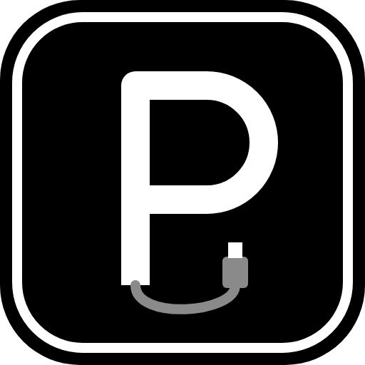

<p align="center"></p>

# Perialls

[Português](README.md) · **English**

A lightweight app for Windows and Linux that shows your peripherals in one place: what is connected,
the battery, the RGB color and the mouse DPI.

It does not replace the brands' apps (G Hub, Synapse etc.). It is just a simple screen for everyday use.

- **Lightweight:** a single screen. It does not start with the system and leaves nothing running in the background.
- **Generic:** recognizes anyone's devices, using what the system itself reports.
  Unknown devices show up too, with just their name and status.

## What it does

| Feature | Works with |
|---|---|
| Device list and status | Any USB, HID, Bluetooth or audio device |
| Battery | Bluetooth devices that report battery, controllers (XInput on Windows; the ones the kernel knows on Linux) and Logitech (HID++) |
| RGB color | Everything [OpenRGB](https://openrgb.org) recognizes (motherboard, fans, strips, peripherals) |
| DPI | Logitech mice with HID++ |
| Effect, color, brightness, speed and polling rate | Akko/MonsGeek FUN60 PRO keyboard |
| Extra features through drivers | Devices with a driver in [`drivers/`](drivers), downloaded by the app itself |
| Sync RGB | The same color on every RGB device, in one click |

## How to use

1. **[Download the latest version](https://github.com/arthurgdelima-dev/perialls/releases/latest)** and
   open it. Nothing to install, not even OpenRGB: it already comes bundled, in the `openrgb` folder.
   - **Windows:** `Perialls-win-x64.zip`. Extract **everything** (right-click → *Extract All*) and open
     `Perialls.exe`. It needs the `openrgb` folder next to it.
   - **Linux:** `Perialls-linux-x64.tar.gz`. Extract it and open it:
     ```
     tar -xzf Perialls-linux-x64.tar.gz
     cd Perialls-linux-x64
     chmod +x Perialls   # the .tar.gz already keeps the permission; only needed if it gets lost
     ./Perialls
     ```
   - `SHA256SUMS.txt` has each file's hash, if you want to check the download.

   > **"Windows protected your PC"?** This warning shows up because the `.exe` is not digitally
   > signed (the certificate costs money). Click **More info → Run anyway**. All the code is here in
   > the repository, if you want to check it or build it yourself.

2. **Linux, for Logitech and Akko/MonsGeek:** Linux only lets root talk directly to these devices.
   Install the udev rule once (it only grants access to whoever is using the PC):
   ```
   sudo curl -L -o /etc/udev/rules.d/70-perialls.rules https://raw.githubusercontent.com/arthurgdelima-dev/perialls/main/linux/70-perialls.rules
   sudo udevadm control --reload && sudo udevadm trigger
   ```
   (Or, with the repository downloaded: `sudo cp linux/70-perialls.rules /etc/udev/rules.d/`.)
   Then unplug the device and plug it back in. Without the rule they show up in the list, but without
   battery, DPI and lighting (the app's footer tells you).
3. **RGB:** works on its own, with the bundled [OpenRGB](https://openrgb.org). It is only turned on
   when you pick a color or use *Sync RGB* (the footer shows "Turning on RGB..." for a few seconds while
   it looks for the devices). It runs hidden, as a server only, without applying any profile, stays open
   while Perialls is open and closes with it. If you already have OpenRGB open with the *SDK Server* on,
   Perialls uses yours.
   - **Linux:** OpenRGB needs a udev rule to open USB devices. If it is missing, the footer shows the
     exact command. RAM and some motherboards use i2c; for them, also turn on the module:
     `echo i2c-dev | sudo tee /etc/modules-load.d/i2c-dev.conf && sudo modprobe i2c-dev`.
   - **Windows:** RAM and some older motherboards (the ones that use SMBus) don't work yet, because
     OpenRGB would need to run as administrator. USB devices, like most current motherboards (e.g. MSI
     Mystic Light), fans, strips and peripherals, work normally.
4. Click **Refresh** whenever you connect or disconnect a device. The app does not keep checking on
   its own.

**The app never changes anything on its own.** When it opens, it only reads the devices. Color, DPI,
polling rate and the rest are only sent when you change something on screen. Your last choice for each
device is kept in `%AppData%\Perialls\settings.json` (on Linux, `~/.config/Perialls/settings.json`), only to
show on screen what you picked when the device does not report its own state. It is not reapplied on
startup. When the device has its own memory and OpenRGB or the driver know how to write to it, the
setting is also saved on the device.

**Double-click a device's name** to rename it (Enter saves, Esc cancels, empty restores the original
name). Names are kept in `%AppData%\Perialls\nomes.txt` (on Linux, `~/.config/Perialls/nomes.txt`).

The **drop** button in the sidebar **syncs RGB**: the chosen color goes to every RGB device at once. If
one fails, the footer says which one, and the others get the color normally.

The **language** (Portuguese or English) is at the bottom of the sidebar (`PT`/`EN`). The first time,
the app uses the system language.

Hover over a card to **hide** a device you don't want to see. The eye button in the sidebar shows the
hidden ones again. The hidden list is kept in `%AppData%\Perialls\ocultos.txt` (on Linux, `~/.config/Perialls/ocultos.txt`).

### Drivers

A small icon shows up in the corner of each card:

| Icon | Meaning |
|---|---|
| ⬇ | There is a driver for the device. Click to download it: the features show up right away. |
| ⟳ | There is a new version of the driver. |
| ✓ | Driver installed. |
| ➕ | No support yet. Click to open a request on GitHub, already filled in with the device's details. |

Drivers are just JSON files that describe the commands. The app never downloads programs, checks each
driver's hash against the index and blocks dangerous commands (firmware, reset). They are kept in
`%LocalAppData%\Perialls\drivers` (on Linux, `~/.local/share/Perialls/drivers`).

Want to write a driver for a device? See [how to add a device](docs/como-adicionar-um-aparelho.md)
(in Portuguese).

### Akko/MonsGeek FUN60 PRO keyboard
- Close the official software (MonsGeek Driver and the `iot_driver` that runs in the background) and the
  web driver before using it, so the two don't fight over the keyboard.
- On Linux, it needs the udev rule (step 2 above).
- The app checks the model by the ID the keyboard itself reports. If it is not a known model, the
  controls don't show up.
- **Polling rate:** the official software only offers this option on newer firmware. Perialls offers it
  on any firmware, so use it at your own risk. If the keyboard stops responding, unplug it and plug it
  back in.
- How the protocol works: [docs/protocolo-monsgeek.md](docs/protocolo-monsgeek.md) (in Portuguese).

## Building

You need the [.NET 8 SDK](https://dotnet.microsoft.com/download/dotnet/8.0).

```
dotnet run --project Perialls.csproj
```

To build the single executable (about 45 MB, because .NET goes with it). You can build both from
either system:

```
dotnet publish Perialls.csproj -p:PublishProfile=win-x64     # goes to publish\Perialls.exe
dotnet publish Perialls.csproj -p:PublishProfile=linux-x64   # goes to publish/linux/Perialls
```

## Publishing a version

Releases are made automatically by GitHub Actions ([.github/workflows/release.yml](.github/workflows/release.yml)).
Just create a tag that starts with `v` and push it:

```
git tag v0.2.0
git push --tags
```

A few minutes later the Release shows up with the Windows `.zip` and the Linux `.tar.gz` (both already
with OpenRGB, a pinned version with its hash checked), the OpenRGB source code, the hashes and notes
generated from the commits. To follow it, see the repository's *Actions* tab.

## Device photos

Photos are automatic: nobody needs to add images. When a device has no saved photo, the app looks for
one on the internet in the background (Bing and, if that fails, DuckDuckGo) and keeps it only on your PC,
in `%LocalAppData%\Perialls\imagens` (on Linux, `~/.local/share/Perialls/imagens`). To do that, **the
device's name (brand and model) is sent to the search engine**. The search only accepts images with a
transparent background and a square shape; if nothing fits or there is no internet, the card shows the
type icon and the app tries again on the next Refresh.

The USB code (VID/PID) shows up in Device Manager: *Properties* → *Details* → *Hardware Ids*.
On Linux, in the `lsusb` command (e.g. `ID 046d:4093` becomes `VID_046D&PID_4093`).

## Bundled OpenRGB

The `openrgb` folder contains [OpenRGB](https://openrgb.org) 1.1, unmodified. It is a separate program,
licensed under the **GNU GPL version 2**; Perialls only talks to it over the local network, and the code
of the two is not combined. Its license is in `openrgb/LICENSE`, and the source code of the exact version
is attached to every Release (`OpenRGB-1.1-source.tar.gz`). More details, and the offer of the source code
of the libraries it uses, in [openrgb/SOURCE.md](openrgb/SOURCE.md).

## Libraries

- [Avalonia](https://avaloniaui.net): the screen, the same on Windows and Linux.
- [HidSharp](https://www.zer7.com/software/hidsharp): talks to HID devices (Logitech and Akko).
- [OpenRGB.NET](https://github.com/diogotr7/OpenRGB.NET): OpenRGB SDK client over the network.
  OpenRGB itself is a separate program (GPL), bundled in the `openrgb` folder (see above).
- System.Management: lists devices on Windows (WMI). On Linux the list comes from `/sys` and
  Bluetooth from BlueZ (through `busctl`, which ships with systemd).

## License

[MIT](LICENSE): use, copy and modify freely, as long as you keep the copyright notice.
